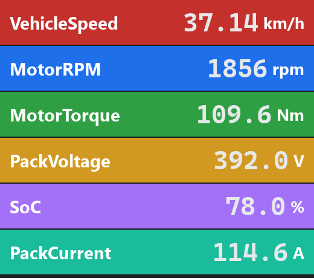
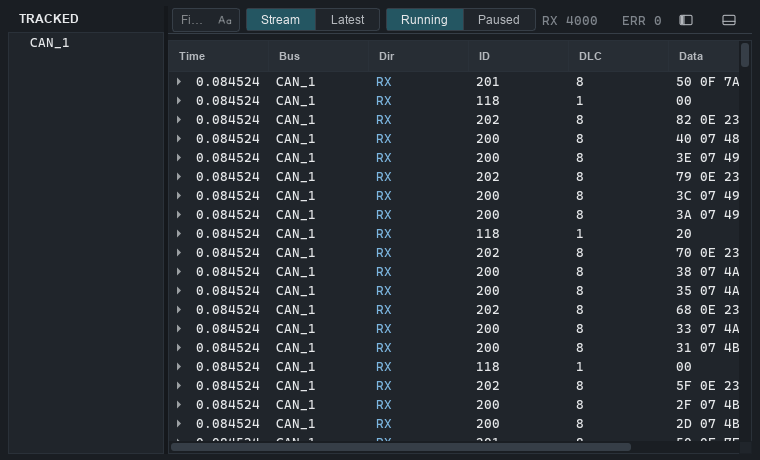

# ithildin

Open-source CAN bus analyser with a built-in MCP server.

[](https://github.com/tobias-hallberg/ithildin-can-analyzer/actions/workflows/test.yml)
[](https://github.com/tobias-hallberg/ithildin-can-analyzer/actions/workflows/lint.yml)
[](LICENSE)


> **Status:** beta. The v0.1 feature set is complete and tested, but it
> has only been run on a handful of adapters so far — expect rough edges,
> and [hardware reports](CONTRIBUTING.md#reporting-bugs) are very welcome.

## What it is

A cross-platform (Windows + Linux) CAN bus analyser aimed at the gap
between [BusMaster](https://rbei-etas.github.io/busmaster/) (free but
dated UX) and [CAN Easy](https://www.ixxat.com/can-easy) (better UX but
proprietary). It captures CAN traffic from PEAK, Kvaser, CANable /
CANtact / candleLight, and IXXAT hardware (plus SocketCAN on Linux),
decodes via DBC files, logs and replays sessions, and ships a built-in MCP
server so AI agents can observe traffic and (under strict
per-message/per-signal allowlists) transmit frames.

|  |  |
|---|---|
|  |  |
| Signal Monitor — decoded values + range gauges | Trace — live per-channel frame log |

<sub>Screenshots show the bundled `examples/drive_5min.blf` demo replayed
onto the virtual bus. Regenerate with `scripts/make_screenshots.py`.</sub>

## Features

What works today:

- **Live capture** from the supported `python-can` backends — PEAK
  (`pcan`), Kvaser, CANable / CANtact / candleLight (`gs_usb`), IXXAT,
  SocketCAN on real hardware, plus `virtual` for tests and demos. Single
  bus in v0.1. Listen-only is available on PEAK, Kvaser, `gs_usb` (when
  the adapter's firmware supports it), and `virtual`; SocketCAN (silent
  mode is an OS-level `ip link` property) and IXXAT (the VCI wrapper
  hardcodes its opmode) expose no python-can kwarg for it, so that
  combination is rejected rather than left ACKing on the wire.
- **DBC decode** via `cantools`. Add a `.dbc` to a bus with **+ DBC** in
  the Buses panel (or pick it while creating the bus) and its signals +
  messages appear in the left dock, draggable onto views.
- **Trace view** — live frame log per channel, multi-instance, with
  filter strip and pause / RX / ERR counts.
- **Signal Plot** — `pyqtgraph` rolling-window curves; drop a signal
  from the left dock to add a curve.
- **Signal Monitor** — table of decoded signal values with min / max
  observed and a range gauge.
- **Data view** — live table of decoded signals with unit and a range
  gauge scaled to the DBC-declared min / max rather than observed values.
- **Frame Inspector** — auto-spawns from Trace selection; shows raw
  bytes + decoded signals (raw int + scaled value + DBC unit), plus
  message sender and cycle period when the DBC declares them.
- **Record / Replay** — write to BLF (default) or ASC; replay drives
  the bus from a file via `ReplayController` (linear playback only —
  pause and scrub land in v0.2).
- **Transmit** — one-shot and periodic sends behind a master switch,
  with per-signal controls matched to the signal type. Multiplexed
  messages get a dropdown of their selector IDs and show only the
  selected branch. Integer signals wider than 53 bits are edited as hex
  bytes and sent exactly; with a fractional factor they are still
  limited to float precision.
- **MCP server** — bearer-token-gated, loopback-only streamable-HTTP
  transport with ten read tools (bus, DBC, and traffic introspection) and
  two write tools (`send_signal`, `send_frame`) routed through a
  default-deny `AllowRule` allowlist with DBC range enforcement, per-rule
  token-bucket rate limiting, and a JSONL audit log. See
  [Using the MCP server](#using-the-mcp-server) to set it up and
  [SECURITY.md](SECURITY.md) for the full safety model.
- **Theme** — token-driven dark and light palettes, theme-tinted SVG
  icons, comprehensive QSS covering toolbar / docks / tables / lists /
  MDI subwindows.

What's not here yet (v0.1 non-goals): macOS, multi-bus simultaneous
capture, CAN FD, UDS / ISO-TP transport, J1939, DBC editor.

Deferred to v0.2: cyclic / periodic MCP transmit, replay pause and
scrub, the Capture and MCP sections of the Settings dialog (only Plot
defaults exist today), the Data view's sample-history spreadsheet (it
shows live values today), and bit-spanning hover highlight in the Frame
Inspector.

## Try it in 60 seconds (no hardware)

The `virtual` backend needs no driver, and the repo ships a 5-minute
synthetic EV-drivetrain log:

```sh
uv sync
uv run ithildin examples/demo.itp
```

Then, in the app:

1. Press **Connect** in the toolbar — it opens the pre-declared `CAN_1`
   virtual bus.
2. Select `CAN_1` in the **Buses** panel, press **+ DBC**, and pick
   `can_database.dbc` from the repo root.
3. Open a **Replay** window, pick `examples/drive_5min.blf`, and hit Play.
4. Open a **Signal Monitor** or **Signal Plot** and drag signals in from
   the left dock to watch them move.

## Install

End users — grab a pre-built installer from the
[Releases page](https://github.com/tobias-hallberg/ithildin-can-analyzer/releases):

- **Windows** — download `Ithildin-<version>-Setup.exe` and run it. The
  installer offers per-user (no admin) or per-machine installation.
- **Ubuntu / other Linux** — download
  `Ithildin-<version>-x86_64.AppImage`, `chmod +x` it, and double-click
  (or run from a terminal). Tested on Ubuntu 22.04 and 24.04.

Hardware vendor drivers are a separate install — see [Drivers](#drivers).

## Drivers

The installer bundles the Python `python-can` interface wrappers but
not the kernel-level / vendor drivers your CAN hardware needs. Install
the one matching your adapter:

- **PEAK** (PCAN-USB, PCAN-PCI, …) — driver setup from
  [peak-system.com](https://www.peak-system.com/Drivers.523.0.html).
- **Kvaser** (Leaf, USBcan, …) —
  [kvaser.com/download](https://www.kvaser.com/download/).
- **CANable / CANtact / candleLight** (`gs_usb` firmware) — on Windows
  10/11 the adapter binds WinUSB by itself; if it shows up without a
  driver, bind WinUSB with [Zadig](https://zadig.akeo.ie/). libusb ships
  with Ithildin. On Linux the kernel's `gs_usb` driver exposes the adapter
  as SocketCAN (`can0`), so use the `socketcan` backend there. Adapters
  running slcan firmware are not supported.

The built-in `virtual` backend works with no driver and is handy for
trying the UI without hardware.

## Run from source

```sh
uv sync
uv run ithildin                       # opens with no project loaded
uv run ithildin path/to/project.itp   # opens that project
```

## Using the MCP server

The server is off by default. To bring it up:

1. Click **MCP** in the toolbar.
2. Press **Start**. The status bar switches to `MCP on · :7320` and the
   dialog shows the URL — `http://127.0.0.1:7320/mcp`.
3. Copy the bearer token from the dialog. It lives at
   `~/.ithildin/<project>/mcp_token`, never in the `.itp`.
4. Point your client at that URL with an
   `Authorization: Bearer <token>` header. For Claude Code:

   ```sh
   claude mcp add --transport http ithildin http://127.0.0.1:7320/mcp \
     --header "Authorization: Bearer <token>"
   ```

To start it automatically with a project, set `enabled = true` under
`[mcp]` in the `.itp`. `dry_run = true` there makes every send authorise,
range-check, and audit as normal but stop short of the wire — the safest
way to let a new agent loose.

### Tools

Read tools are always available. **Write tools reach the bus and are
default-deny** — a send with no matching allowlist rule is rejected.

Add rules in the same MCP dialog. **Add rule…** picks the message and
signal from your loaded DBCs and shows the signal's unit and range as
you choose (the DBC's range, narrowed to what the signal's bits can
hold), so you can see what you're authorising; a raw CAN ID like
`0x301` is still accepted for traffic with no DBC. Leave the rate limit at
`unlimited` or dial in a ceiling in Hz. Then watch the audit feed at the
bottom of the dialog as the agent works.

| Tool | Purpose |
|---|---|
| `list_buses` | Open buses with interface, channel, bitrate, listen-only, bound DBCs |
| `get_bus_stats` | Open state and per-bus frame totals |
| `list_dbcs` | Loaded DBC files, their bus bindings, and counts |
| `list_messages` | Every message in the loaded DBCs — **start here** |
| `list_signals` | Full signal metadata for one message, value tables and multiplexer IDs included |
| `describe_signal` | Metadata for a single `Message.Signal` |
| `get_recent_messages` | Recent decoded frames; filter by ID, bus, or timestamp |
| `get_signal_value` | Latest observed value of one signal |
| `list_allowlist` | The rules currently authorising sends |
| `get_audit_log` | Recent send decisions — why a send was allowed or denied |
| `send_signal` | Encode + send one signal value (allowlist-gated); a multiplexed signal sets its selector |
| `send_frame` | Send a raw frame by ID + hex payload (needs a wildcard rule) |

Both write tools take an optional `bus` argument, required only when more
than one bus is open. The `agent` argument is self-declared by the
caller, so `agent_filter` on a rule separates well-behaved agents — it is
not an authentication boundary. The bearer token is the only real gate.
See [SECURITY.md](SECURITY.md) for the full model.

## Project layout

```
src/ithildin/
├── core/            # UI-agnostic data pipeline
│   ├── bus.py            BusController: python-can wrapper, threaded RX
│   ├── ringbuf.py        bounded ring buffer with per-consumer cursors
│   ├── decoder.py        cantools-backed DBC decoder
│   ├── logger.py         tee logger (BLF / ASC writer)
│   ├── replay.py         ReplayController: drive a bus from a log file
│   ├── transmit.py       TX engine: one-shot + periodic cyclic tasks
│   └── types.py          FrameRecord, BusName
├── workspace/       # .itp project file (TOML schema v2)
├── app_state/       # process-level singletons
│   ├── bus_reader.py     wraps BusController; emits frames_received
│   ├── database.py       wraps Decoder; emits database_changed
│   ├── project.py        .itp open / save / migrate
│   ├── recent_projects.py  recently opened .itp files
│   └── context.py        AppContext dataclass (frozen)
├── mcp/             # MCP server + allowlist
│   ├── permissions.py    AllowRule + AllowlistStore
│   ├── audit.py          JSONL audit writer with size rotation
│   ├── auth.py           bearer token: load or mint ~/.ithildin/<project>/mcp_token
│   ├── tools.py          read + write tools
│   ├── server.py         FastMCP build + tool registration
│   └── bridge.py         Qt↔asyncio bridge (worker thread)
├── ui/              # PySide6 + pyqtgraph
│   ├── main_window.py    single QMainWindow + QMdiArea
│   ├── window_manager.py MDI subwindow registry + layout JSON
│   ├── theme.py          ThemeManager + tokens + QSS
│   ├── icons.py          theme-tinted SVG factory
│   ├── trace_window.py / signal_plot.py / signal_monitor.py / data_view.py …
│   ├── transmit/         TX window widgets (controls, master switch, …)
│   └── …                 (one module per child window / dialog)
└── resources/       # bundled SVG icons (icons/) + logos (logos/)
```

## Development

```sh
QT_QPA_PLATFORM=offscreen uv run pytest   # virtual CAN backend, offscreen Qt
uv run ruff check src tests
uv run ruff format --check
uv run mypy src                           # strict mode
```

CI runs Linux + Windows × Python 3.12 / 3.13 with the `python-can`
`virtual` backend and offscreen Qt; `import ithildin` does no vendor
work, and adapter detection runs on a background `QThread` after the
window paints (`ui/adapter_prober.py`).

See [CONTRIBUTING.md](CONTRIBUTING.md) for the full setup, the coding
conventions, and how to add a view or an MCP tool.

## Building installers

The release artifacts (Windows `.exe`, Linux `.AppImage`) are built by
GitHub Actions in `.github/workflows/release.yml` — pushing a `v*` tag
attaches both to a Release. Build inputs live under `packaging/`:

- `packaging/ithildin.spec` — shared PyInstaller spec (run with
  `uv run pyinstaller packaging/ithildin.spec --noconfirm`).
- `packaging/windows/installer.iss` — Inno Setup script; build with
  `iscc /DAppVersion=<version> packaging\windows\installer.iss`.
- `packaging/linux/build-appimage.sh` — wraps the PyInstaller output
  into an AppImage; needs `appimagetool` on PATH and `libfuse2`
  installed.

## Contributing

Issues and PRs are welcome. Start with [CONTRIBUTING.md](CONTRIBUTING.md)
and the [Code of Conduct](CODE_OF_CONDUCT.md). Notable changes are
recorded in [CHANGELOG.md](CHANGELOG.md).

## Security

ithildin can transmit onto a live CAN bus, including under agent control.
Before enabling the MCP server, read the safety model and reporting
process in [SECURITY.md](SECURITY.md). **Do not report vulnerabilities as
public issues.**

## License

GPL-3.0-or-later. See [`LICENSE`](LICENSE).
